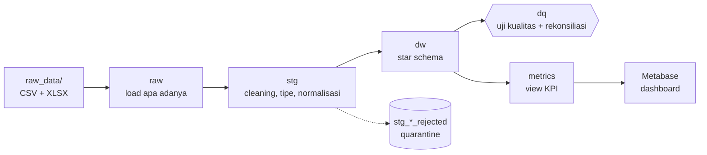
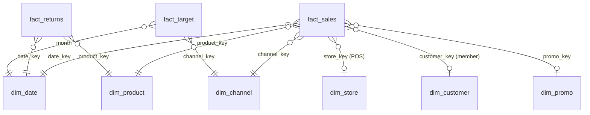

# KIRANA Omnichannel Performance Intelligence


Solusi Business Intelligence end-to-end untuk peritel omnichannel fiktif **KIRANA Home & Living**:
dari ±474 ribu baris transaksi mentah di beberapa sistem yang tidak terhubung, menjadi
**satu sumber angka yang dapat dipercaya**, **semantic layer KPI** di SQL, dan **dashboard keputusan**
untuk Direktur Komersial.

> Proyek akademik (UAS *Business Intelligence Systems*, Sains Data, Universitas Cakrawala). Seluruh
> perusahaan, toko, dan pelanggan dalam data bersifat fiktif.

## Daftar Isi
[Masalah bisnis](#masalah-bisnis) · [Pendekatan](#pendekatan) · [Arsitektur](#arsitektur) ·
[Model data](#model-data) · [Tantangan kualitas data](#tantangan-kualitas-data) · [KPI](#kpi) ·
[Dashboard](#dashboard) · [Tech stack](#tech-stack) · [Struktur repo](#struktur-repo) ·
[Cara menjalankan](#cara-menjalankan) · [Tata kelola](#tata-kelola-dan-privasi) · [Status](#status)

## Masalah Bisnis

KIRANA memiliki 18 toko (Jawa, Bali, Sumatera) dan tiga kanal digital (Website, Mobile App,
Marketplace). Selama Januari 2024 – Juni 2026 penjualan tumbuh, tetapi:

- gross margin cenderung turun;
- pencapaian target tidak merata antar-channel, region, dan toko;
- angka tim komersial dan finance berbeda karena data tersebar di export POS, export e-commerce,
  dan file Excel target.

**Keputusan yang harus diambil (awal Juli 2026):**

1. Bagaimana merealokasikan anggaran promo antar-channel, kategori, dan mekanisme promo?
2. Toko atau region mana yang masuk program perbaikan kinerja H2 2026?

### Pertanyaan bisnis

1. Bagaimana pencapaian net sales FY2025 dan H1 2026 terhadap target per channel, region, dan toko?
2. Bagaimana tren, musiman, dan pergeseran kontribusi antar-channel?
3. Kategori, channel, dan promo mana yang menekan gross margin dan contribution margin (setelah biaya channel)?
4. Seberapa efektif promo Ramadan, Clearance, Member Day, App Payday, Mega Sale, dan Harbolnas terhadap penjualan dan margin?
5. Toko mana yang berkinerja rendah, dan apakah penyebabnya bisnis (tren, kompetisi, renovasi) atau masalah data?
6. Bagaimana tingkat dan alasan retur per kategori dan channel?
7. Bagaimana aktivitas dan repeat purchase member per channel?

## Pendekatan

| Prinsip | Penerapan |
| --- | --- |
| **Raw data tidak disentuh** | Semua pembersihan ada di SQL DuckDB dan dirujuk ke Data Quality Issue Log |
| **Idempoten** | Satu entry point membangun ulang database dari `raw_data/`; dua kali run menghasilkan angka identik |
| **Tidak ada baris hilang tanpa jejak** | Baris tertolak masuk tabel quarantine; rekonsiliasi raw → fakta ditutup sampai selisih 0 |
| **Satu definisi per metrik** | KPI hidup sebagai view SQL; Metabase hanya membaca view |
| **Histori yang benar** | HPP, tarif biaya channel, dan region toko dihitung *as-of* tanggal transaksi |
| **Privasi sejak desain** | Kolom PII tidak masuk model analitik; ada uji otomatis yang memeriksanya |

## Arsitektur



Database tunggal `kirana.duckdb` dengan schema `raw → stg → dw → dq → metrics`.

## Model Data

Fakta penjualan menyatukan transaksi POS dan online pada grain **satu item baris transaksi valid**.



| Tabel | Grain |
| --- | --- |
| `fact_sales` | 1 item baris transaksi (`trx_id`/`order_no` + `line_no`), POS ∪ online |
| `fact_returns` | 1 retur per item (`return_id`) |
| `fact_target` | 1 bulan × channel × region/nasional (hasil unpivot dari Excel) |

**Keputusan SCD**

- **HPP produk** (`product_cost_history`): COGS memakai HPP yang berlaku pada tanggal transaksi, bukan HPP terkini, agar margin historis tidak bias.
- **Region toko** (`store_region_history`): achievement dibandingkan dengan region *saat transaksi* karena target ditetapkan per region; toko tanpa riwayat memakai region di master.
- **Biaya channel**: tarif *as-of* tanggal (komisi Marketplace naik dari 9,0% ke 11,5% per 1 April 2025).

## Tantangan Kualitas Data

Hasil pemindaian awal pada data mentah (akan dikuantifikasi penuh, termasuk dampak Rupiah, di Issue Log):

| Temuan | Skala |
| --- | --- |
| Kode toko POS tidak konsisten (huruf kecil, kode `TRN-99` yang tidak ada di master) | 38 kode untuk 18 toko |
| Label channel online tidak seragam (`MP`, `APP`, `WEB`, `Web Store`, `mobile_app`, ...) | 12 label untuk 3 channel |
| Harga online tersimpan sebagai teks | ±36 ribu baris |
| Duplikat kunci transaksi | 1.597 (POS), 232 (online) |
| Baris pembatalan (void) kasir POS | 2.086 |
| Order online berstatus `CANCELLED` | 12.745 baris |
| Riwayat region toko hanya mencakup satu toko | 2 baris untuk 18 toko |
| File Excel target dengan judul di atas header dan format bulan melebar | 3 sheet |

## KPI

Seluruh KPI diimplementasikan sebagai view di schema `metrics` dengan pembilang dan penyebut terpisah,
sehingga rasio tetap benar ketika difilter atau di-drill-down di dashboard.

| KPI | Ringkasan definisi |
| --- | --- |
| Net Sales | Penjualan setelah diskon/voucher, tanpa void dan order batal, tanpa pajak |
| Achievement vs Target | Net sales aktual ÷ target (Store per region, online per channel) |
| Gross Margin % | (Net sales − COGS as-of) ÷ net sales |
| Contribution Margin % | Gross margin setelah biaya channel as-of |
| Return Rate | Retur ÷ penjualan pada basis dan periode yang sama |
| AOV | Net sales ÷ jumlah transaksi distinct |
| Transaksi | Jumlah `trx_id` / `order_no` distinct |
| Active Members | Member distinct yang bertransaksi pada periode |
| Repeat Rate | Member dengan ≥ 2 transaksi ÷ active members |
| Promo Lift | Kenaikan penjualan terhadap baseline, beserta dampak margin |

Kamus metrik lengkap (grain, aturan inklusi/eksklusi, pemilik, ambang) dilampirkan pada laporan teknis.

## Dashboard

Dashboard Metabase self-hosted dengan empat tab dan satu halaman storyline:

1. **Executive Overview**: KPI vs target dan tren
2. **Channel, Region & Store Performance**: drill-through sampai toko
3. **Margin & Promotion Effectiveness**: margin, biaya channel, efektivitas promo
4. **Returns & Customers**: retur, member, repeat purchase
5. **Storyline**: temuan utama dan rekomendasi

Fitur: filter periode/channel/region/kategori, click behavior, warna status pencapaian yang konsisten,
indikator kesegaran data dan status sinkronisasi POS, serta penanda periode/toko dengan data tidak lengkap.

## Tech Stack

| Lapisan | Tools |
| --- | --- |
| Transformasi, pemodelan, uji data | [DuckDB](https://duckdb.org/) (SQL) |
| Visualisasi | [Metabase](https://www.metabase.com/) + [driver DuckDB](https://github.com/MotherDuck-Open-Source/metabase_duckdb_driver); PostgreSQL sebagai alternatif koneksi |
| Diagram dan wireframe | draw.io, Mermaid |

## Struktur Repo

```text
.
├── compose.yaml  # Metabase + driver DuckDB (+ PostgreSQL opsional)
├── sql/          # pipeline berurutan: load → staging → model → reconciliation → metrics → tests
├── dashboard/    # wireframe dan SQL tiap kartu Metabase
├── reports/      # laporan teknis, insight brief, evaluasi & tata kelola
└── raw_data/     # data mentah (tidak disertakan di repo)
```

Folder ditambahkan seiring pekerjaan berjalan.

## Cara Menjalankan

**Prasyarat:** DuckDB CLI ≥ 1.4, Docker dengan Compose v2, dan Bash.

1. Letakkan paket data (13 file CSV/XLSX) di folder `raw_data/`. Data tidak dibagikan di repo ini
   karena merupakan materi mata kuliah.
2. Bangun database dari root repo. Skrip membangun ke file sementara dan menggantikan `kirana.duckdb`
   hanya bila semua uji kualitas BLOCKING lolos (pertama kali butuh internet untuk memasang ekstensi
   `excel` DuckDB):

   ```bash
   bash scripts/build.sh
   ```

3. Periksa hasil uji kualitas dan rekonsiliasi:

   ```sql
   SELECT * FROM dq.test_results;
   SELECT * FROM dq.reconciliation;
   ```

4. Jalankan Metabase (image dengan driver DuckDB sudah terpasang):

   ```bash
   cp .env.example .env        # isi METABASE_DB_PASSWORD
   docker compose up -d        # http://localhost:3000
   ```

   Di Metabase: **Admin → Databases → DuckDB**, path `/data/kirana.duckdb`, centang
   *read-only connection*. DuckDB hanya mengizinkan satu penulis, jadi jalankan
   `docker compose stop metabase` sebelum rebuild database.

   Bila driver DuckDB bermasalah, `docker compose --profile fallback up -d` menyalakan PostgreSQL
   sebagai alternatif koneksi.

## Tata Kelola dan Privasi

- Kolom PII member (nama, telepon, email, tanggal lahir) tidak masuk model analitik maupun dashboard;
  `birth_date` hanya dipakai untuk turunan seperti kelompok usia.
- Public sharing dan embedding Metabase dinonaktifkan; akses dibatasi per grup (Finance melihat semua,
  Store Manager hanya region masing-masing).
- Lineage dari sumber ke dashboard, pemilik data, jadwal refresh, monitoring, dan retensi
  didokumentasikan pada lampiran tata kelola.

## Status

- [x] Decision framing dan data profiling ([decision statement](reports/A1_decision_statement.md), [profiling](reports/A2_profiling.md), [issue log](reports/A3_issue_log.md))
- [x] Pipeline SQL idempoten dan star schema ([model, grain, SCD](reports/A4_data_model.md))
- [x] Uji kualitas data dan rekonsiliasi ([hasil uji dan rekonsiliasi](reports/A5_quality_reconciliation.md))
- [x] Metric views dan kamus metrik ([kamus metrik](reports/A7_kamus_metrik.md), [number registry](reports/number_registry.md))
- [ ] Dashboard Metabase
- [ ] Insight brief dan rekomendasi
- [ ] Evaluasi dan tata kelola

Hasil kuantitatif (angka pencapaian, margin, efektivitas promo) ditambahkan setelah pipeline selesai
dan tervalidasi.

## Penggunaan AI

Asisten AI digunakan untuk belajar dan debugging. Seluruh angka dihasilkan dari model data dalam
repo ini.

## Penulis

[@titan2903](https://github.com/titan2903)
