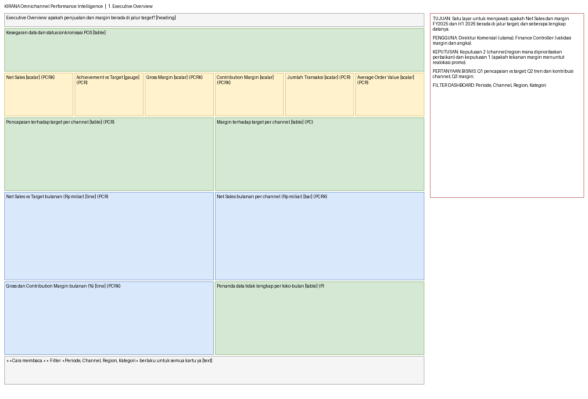
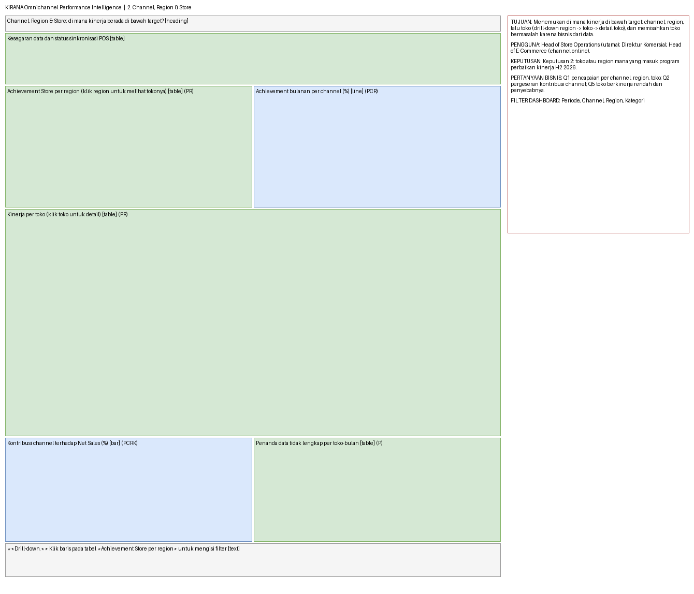
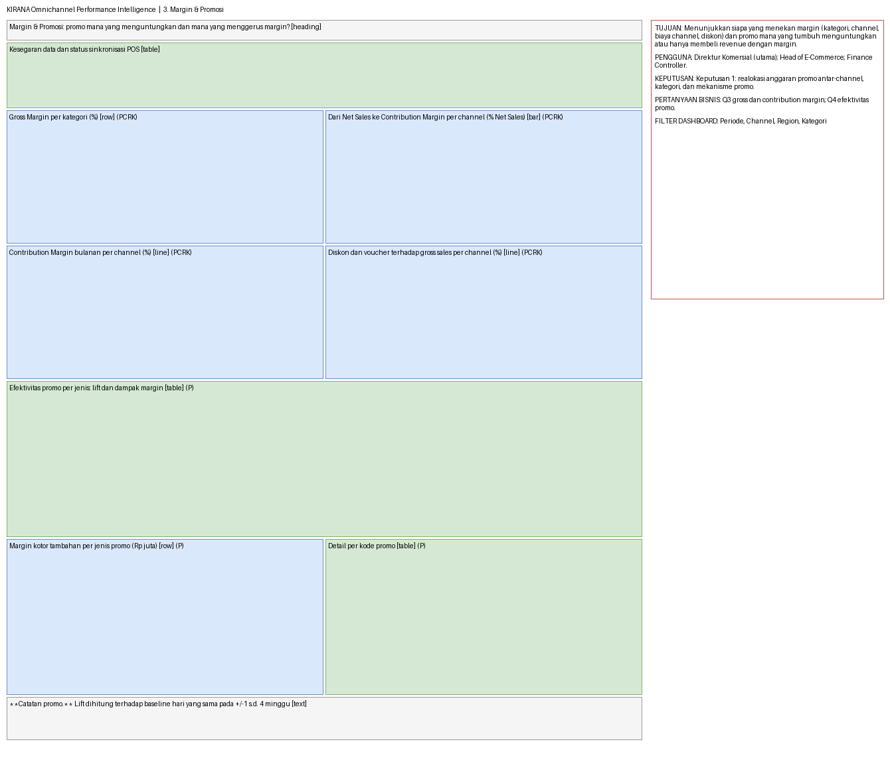
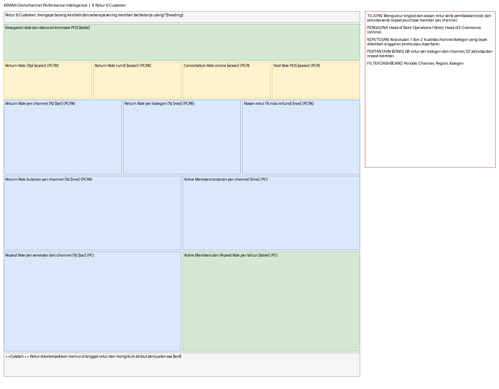
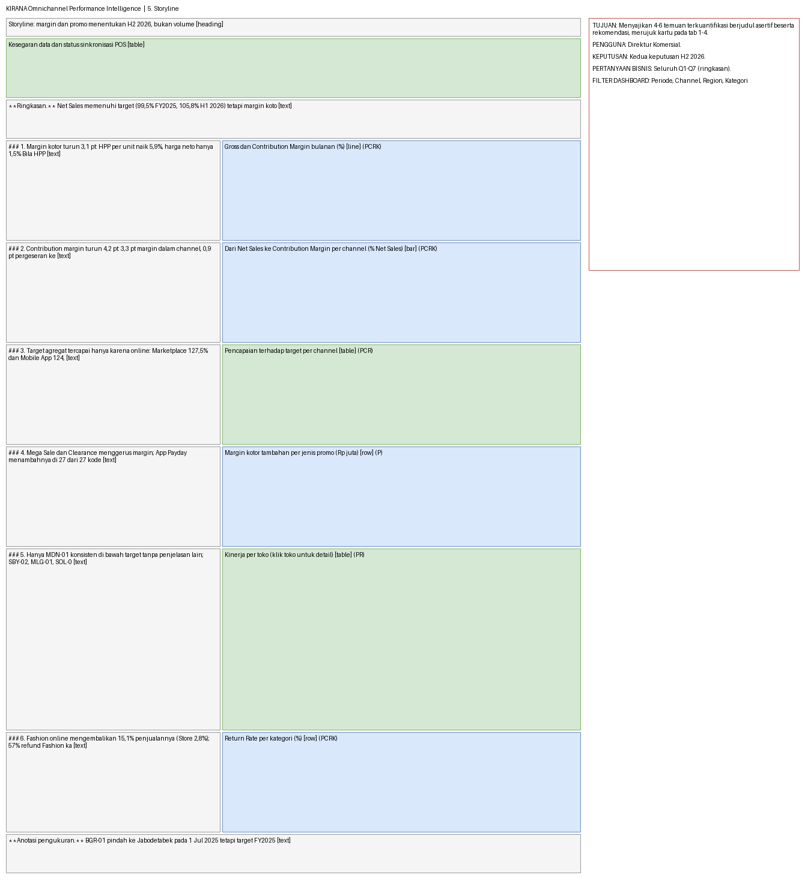
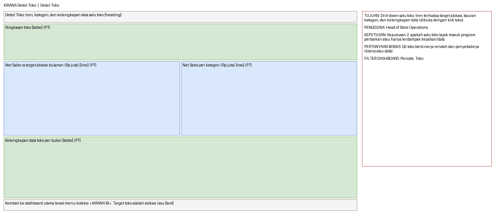

# Wireframe dashboard KIRANA

Dihasilkan oleh `dashboard/wireframe/build_wireframe.py` dari `dashboard/questions/*.sql` dan `dashboard/layout.json`; berkas draw.io (`wireframe.drawio`) dapat diedit dan memuat satu halaman per tab. Kotak = kartu Metabase (kuning = angka utama, hijau = tabel, biru = grafik, abu = teks). Huruf di kanan bawah kotak = filter yang berlaku: **P**eriode, **C**hannel, **R**egion, **K**ategori, **T**oko.

## KIRANA Omnichannel Performance Intelligence: 1. Executive Overview

- **Tujuan:** Satu layar untuk menjawab: apakah Net Sales dan margin FY2025 dan H1 2026 berada di jalur target, dan seberapa lengkap datanya.
- **Pengguna:** Direktur Komersial (utama); Finance Controller (validasi margin dan angka).
- **Keputusan yang didukung:** Keputusan 2 (channel/region mana diprioritaskan perbaikan) dan keputusan 1 (apakah tekanan margin menuntut realokasi promo).
- **Pertanyaan bisnis:** Q1 pencapaian vs target; Q2 tren dan kontribusi channel; Q3 margin.

| Kartu | Bentuk | Filter yang berlaku |
| --- | --- | --- |
| Kesegaran data dan status sinkronisasi POS | table | tidak ada (indikator global) |
| Net Sales | scalar | Periode, Channel, Region, Kategori |
| Achievement vs Target | gauge | Periode, Channel, Region |
| Gross Margin | scalar | Periode, Channel, Region, Kategori |
| Contribution Margin | scalar | Periode, Channel, Region, Kategori |
| Jumlah Transaksi | scalar | Periode, Channel, Region |
| Average Order Value | scalar | Periode, Channel, Region |
| Pencapaian terhadap target per channel | table | Periode, Channel, Region |
| Margin terhadap target per channel | table | Periode, Channel |
| Net Sales vs Target bulanan (Rp miliar) | line | Periode, Channel, Region |
| Net Sales bulanan per channel (Rp miliar) | bar | Periode, Channel, Region, Kategori |
| Gross dan Contribution Margin bulanan (%) | line | Periode, Channel, Region, Kategori |
| Penanda data tidak lengkap per toko-bulan | table | Periode |

## KIRANA Omnichannel Performance Intelligence: 2. Channel, Region & Store

- **Tujuan:** Menemukan di mana kinerja di bawah target: channel, region, lalu toko (drill-down region -> toko -> detail toko), dan memisahkan toko bermasalah karena bisnis dari data.
- **Pengguna:** Head of Store Operations (utama); Direktur Komersial; Head of E-Commerce (channel online).
- **Keputusan yang didukung:** Keputusan 2: toko atau region mana yang masuk program perbaikan kinerja H2 2026.
- **Pertanyaan bisnis:** Q1 pencapaian per channel, region, toko; Q2 pergeseran kontribusi channel; Q5 toko berkinerja rendah dan penyebabnya.

| Kartu | Bentuk | Filter yang berlaku |
| --- | --- | --- |
| Kesegaran data dan status sinkronisasi POS | table | tidak ada (indikator global) |
| Achievement Store per region (klik region untuk melihat tokonya) | table | Periode, Region |
| Achievement bulanan per channel (%) | line | Periode, Channel, Region |
| Kinerja per toko (klik toko untuk detail) | table | Periode, Region |
| Kontribusi channel terhadap Net Sales (%) | bar | Periode, Channel, Region, Kategori |
| Penanda data tidak lengkap per toko-bulan | table | Periode |

## KIRANA Omnichannel Performance Intelligence: 3. Margin & Promosi

- **Tujuan:** Menunjukkan siapa yang menekan margin (kategori, channel, biaya channel, diskon) dan promo mana yang tumbuh menguntungkan atau hanya membeli revenue dengan margin.
- **Pengguna:** Direktur Komersial (utama); Head of E-Commerce; Finance Controller.
- **Keputusan yang didukung:** Keputusan 1: realokasi anggaran promo antar-channel, kategori, dan mekanisme promo.
- **Pertanyaan bisnis:** Q3 gross dan contribution margin; Q4 efektivitas promo.

| Kartu | Bentuk | Filter yang berlaku |
| --- | --- | --- |
| Kesegaran data dan status sinkronisasi POS | table | tidak ada (indikator global) |
| Gross Margin per kategori (%) | row | Periode, Channel, Region, Kategori |
| Dari Net Sales ke Contribution Margin per channel (% Net Sales) | bar | Periode, Channel, Region, Kategori |
| Contribution Margin bulanan per channel (%) | line | Periode, Channel, Region, Kategori |
| Diskon dan voucher terhadap gross sales per channel (%) | line | Periode, Channel, Region, Kategori |
| Efektivitas promo per jenis: lift dan dampak margin | table | Periode |
| Margin kotor tambahan per jenis promo (Rp juta) | row | Periode |
| Detail per kode promo | table | Periode |

## KIRANA Omnichannel Performance Intelligence: 4. Retur & Customer

- **Tujuan:** Mengukur tingkat dan alasan retur serta pembatalan/void, dan aktivitas serta repeat purchase member per channel.
- **Pengguna:** Head of Store Operations (Store); Head of E-Commerce (online).
- **Keputusan yang didukung:** Keputusan 1 dan 2: kualitas channel/kategori yang layak ditambah anggaran promo atau diperbaiki.
- **Pertanyaan bisnis:** Q6 retur per kategori dan channel; Q7 aktivitas dan repeat member.

| Kartu | Bentuk | Filter yang berlaku |
| --- | --- | --- |
| Kesegaran data dan status sinkronisasi POS | table | tidak ada (indikator global) |
| Return Rate (Rp) | scalar | Periode, Channel, Region, Kategori |
| Return Rate (unit) | scalar | Periode, Channel, Region, Kategori |
| Cancellation Rate online | scalar | Periode, Channel, Region |
| Void Rate POS | scalar | Periode, Channel, Region |
| Return Rate per channel (%) | bar | Periode, Channel, Region, Kategori |
| Return Rate per kategori (%) | row | Periode, Channel, Region, Kategori |
| Alasan retur (% nilai refund) | row | Periode, Channel, Region, Kategori |
| Return Rate bulanan per channel (%) | line | Periode, Channel, Region, Kategori |
| Active Members bulanan per channel | line | Periode, Channel |
| Repeat Rate per semester dan channel (%) | bar | Periode, Channel |
| Active Members dan Repeat Rate per tahun | table | Periode, Channel |

## KIRANA Omnichannel Performance Intelligence: 5. Storyline

- **Tujuan:** Menyajikan 4-6 temuan terkuantifikasi berjudul asertif beserta rekomendasi, merujuk kartu pada tab 1-4.
- **Pengguna:** Direktur Komersial.
- **Keputusan yang didukung:** Kedua keputusan H2 2026.
- **Pertanyaan bisnis:** Seluruh Q1-Q7 (ringkasan).

| Kartu | Bentuk | Filter yang berlaku |
| --- | --- | --- |
| Kesegaran data dan status sinkronisasi POS | table | tidak ada (indikator global) |
| Gross dan Contribution Margin bulanan (%) | line | Periode, Channel, Region, Kategori |
| Dari Net Sales ke Contribution Margin per channel (% Net Sales) | bar | Periode, Channel, Region, Kategori |
| Pencapaian terhadap target per channel | table | Periode, Channel, Region |
| Margin kotor tambahan per jenis promo (Rp juta) | row | Periode |
| Kinerja per toko (klik toko untuk detail) | table | Periode, Region |
| Return Rate per kategori (%) | row | Periode, Channel, Region, Kategori |

## KIRANA Detail Toko: Detail Toko

- **Tujuan:** Drill-down satu toko: tren terhadap target alokasi, bauran kategori, dan kelengkapan data (dibuka dengan klik toko).
- **Pengguna:** Head of Store Operations.
- **Keputusan yang didukung:** Keputusan 2: apakah satu toko layak masuk program perbaikan atau hanya terdampak kejadian/data.
- **Pertanyaan bisnis:** Q5 toko berkinerja rendah dan penyebabnya (bisnis atau data).

| Kartu | Bentuk | Filter yang berlaku |
| --- | --- | --- |
| Ringkasan toko | table | Periode, Toko |
| Net Sales vs target alokasi bulanan (Rp juta) | line | Periode, Toko |
| Net Sales per kategori (Rp juta) | row | Periode, Toko |
| Kelengkapan data toko per bulan | table | Periode, Toko |
