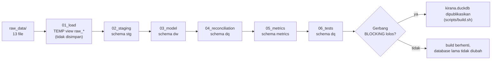
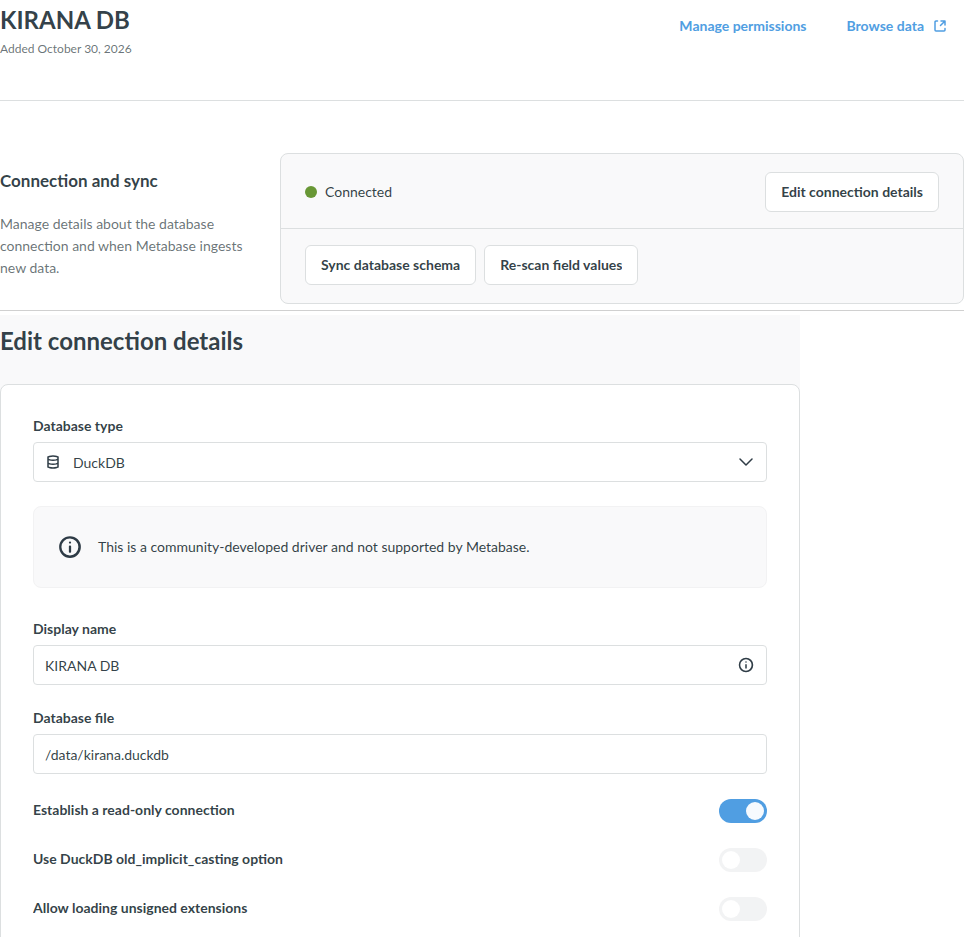
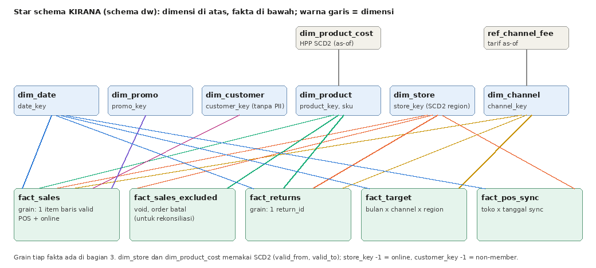

# A4. Pipeline, Star Schema, Grain, dan Keputusan SCD

Semua yang ada di dokumen ini dihasilkan oleh `duckdb kirana.duckdb < sql/00_main.sql` (sekitar 4 detik,
idempoten) dan dapat diverifikasi ulang. Pengujian dan rekonsiliasi ada di [A5](A5_quality_reconciliation.md).

## 1. Alur data

| Lapisan | File | Isi | Catatan |
| --- | --- | --- | --- |
| load | `01_load.sql` | View `raw_*` atas file CSV/XLSX, semua kolom VARCHAR | **TEMP**: tidak ikut tersimpan. Raw memuat PII dan path `raw_data/` yang tidak ada di container Metabase |
| staging | `02_staging.sql` | Normalisasi, tipe, dedup, pasangan void, karantina; `disposition` per baris | Tiap perlakuan diberi komentar `-- DQ-xx` |
| model | `03_model.sql` | Dimensi dan fakta (star schema) | Tanpa PII |
| rekonsiliasi | `04_reconciliation.sql` | `dq.reconciliation`, `dq.net_sales_bridge` | Sisi mentah dihitung dari raw, bukan dari stg |
| semantic layer | `05_metrics.sql` | `metrics.v_*`, `metrics.ref_status_threshold`, `metrics.kpi_dictionary` | Satu-satunya tempat rumus KPI; lihat [A7](A7_kamus_metrik.md) |
| uji | `06_tests.sql` | `dq.test_results`, `dq.test_results_demo` | Gerbang di `00_main.sql`; 43 uji, termasuk 15 uji semantic layer, region, dan akses (T40–T54) |

`kirana.duckdb` memuat schema `stg`, `dw`, `dq`, `metrics`, dan enam schema akses `acc_<region>` (Task 6). Tidak ada kolom PII di database ini.

Metabase membaca file ini lewat driver DuckDB (koneksi *KIRANA DB*, file `/data/kirana.duckdb` di container) dengan **koneksi read-only**, sehingga dashboard tidak dapat mengubah model; rebuild dilakukan setelah Metabase dihentikan (DuckDB hanya satu penulis).

## 2. Star schema

| Tabel | Baris | Kunci |
| --- | ---: | --- |
| `dw.fact_sales` | 455.050 | `sales_key`; grain `(source_system, txn_id, line_no, product_key)` |
| `dw.fact_sales_excluded` | 16.867 | `excluded_key` |
| `dw.fact_returns` | 18.089 | `return_key` / `return_id` |
| `dw.fact_target` | 162 | `target_key`; `(month_start, channel_key, region)` |
| `dw.fact_pos_sync` | 16.036 | `sync_key`; `(store_code, business_date)` |
| `dw.dim_date` | 1.096 | `date_key` (yyyymmdd), 2024-01-01 s.d. 2026-12-31 |
| `dw.dim_product` | 600 | `product_key`, `sku` |
| `dw.dim_product_cost` | 850 | SCD2 HPP |
| `dw.dim_store` | 20 | SCD2 region; `store_key` -1 = online |
| `dw.dim_channel` | 4 | Store, Website, Mobile App, Marketplace |
| `dw.dim_customer` | 42.321 | tanpa PII; `customer_key` -1 = non-member |
| `dw.dim_promo` | 75 | 73 promo + `B2B-CORP` + `NONE` (-1) |
| `dw.ref_channel_fee` | 5 | tarif as-of per channel |
| `dw.dim_store_event` | 1 | renovasi SBY-01 |

## 3. Pernyataan grain

| Fakta | Grain |
| --- | --- |
| `fact_sales` | **Satu baris = satu item baris transaksi valid**: POS `trx_id + line_no + sku`, online `order_no + line_no + sku`. Valid berarti sudah dedup, bukan void maupun baris asli yang di-void, bukan order `CANCELLED`, dan toko ada di master. POS dan online berada dalam satu tabel dengan kolom `source_system` |
| `fact_sales_excluded` | Satu baris = satu item baris yang **bukan penjualan** (void, baris asli yang di-void, order batal). Dipakai untuk cancellation rate dan void rate |
| `fact_returns` | Satu baris = satu `return_id` (retur per item) yang terhubung ke penjualan valid |
| `fact_target` | Satu baris = satu bulan x channel x (region untuk Store, `Nasional` untuk online) |
| `fact_pos_sync` | Satu baris = satu toko x tanggal bisnis di sync log |

Kolom ukuran di `fact_sales`: `qty`, `unit_price`, `gross_sales`, `discount`, `net_sales`, `unit_cost`, `cogs`,
`gross_margin`, `channel_fee_pct`, `channel_fee`. Flag: `is_member`, `is_b2b_bulk`, `key_collision`,
`province_source`. Region: `region_target_basis` (dasar achievement), `region_asof`, dan `region_current`.

## 4. Keputusan pembersihan yang diterapkan di staging

| ID | Perlakuan di `02_staging.sql` | Hasil |
| --- | --- | --- |
| DQ-01, 03 | `upper(trim())` pada `store_code` dan `sku` | Semua SKU cocok ke master; toko terpetakan |
| DQ-02 | `TRN-99` → `REJECT_STORE_NOT_IN_MASTER` | 320 baris (324 dengan salinan) dikarantina |
| DQ-04, 10 | Dedup persis (`GROUP BY ALL`, `n_copies`) | 1.577 POS dan 232 online salinan ekstra |
| DQ-05 | Tabrakan nomor struk dipertahankan, ditandai `key_collision` | 20 grup; seluruhnya melibatkan pasangan void sehingga tidak ada di `fact_sales` |
| DQ-06 | Void dipasangkan 1:1 dengan baris asli (`trx_id`, `sku`, `qty` berlawanan) | 2.067 void dan 2.067 baris asli dikeluarkan |
| DQ-07 | B2B bulk dipertahankan, `is_b2b_bulk` | 14 baris, `B2B-CORP` masuk `dim_promo` |
| DQ-08 | Pemetaan eksplisit 12 label channel | Label tak dikenal → `REJECT_UNMAPPED_CHANNEL` (diuji) |
| DQ-09 | Parser harga hanya dua pola (`100900`, `Rp100.900`) | Pola lain → `REJECT_UNPARSEABLE` (diuji) |
| DQ-11 | Order `CANCELLED` → `EXCLUDE_CANCELLED` | 12.733 baris, disimpan di `fact_sales_excluded` |
| DQ-12 | Provinsi kosong **disimpulkan dari `ship_city`** bila kota hanya berpasangan dengan satu provinsi | Seluruh 1.984 baris terselesaikan (`province_source = INFERRED_FROM_CITY`) |
| DQ-13, 14 | Satu baris per SKU (buang varian `(old)`), kategori dibakukan | 600 SKU; 6 dikarantina |
| DQ-16 | Target di-unpivot, label region dibakukan | 162 sel |
| DQ-18, 19 | `age_band` dari `birth_date`; flag `possible_duplicate_member` dari email ganda; PII dibuang | 418 `Tidak diketahui`; 982 member ditandai |
| DQ-21, 22 | Retur yatim dikarantina; label alasan digabung | 1 retur ditolak |

**Pemetaan region online.** Region ditentukan dari **provinsi tujuan** sesuai panduan paket data. Banten → Jabodetabek
(satu-satunya kota di data adalah Tangerang, sama dengan toko TGR-01); Sulawesi Selatan dan Kalimantan Timur → `Lainnya`.
Keterbatasan: kota Bekasi, Bogor, dan Depok berada di provinsi Jawa Barat sehingga masuk region `Jawa Barat`, padahal
toko di kota yang sama berada di `Jabodetabek`. Target online ditetapkan per channel nasional, sehingga ini hanya
memengaruhi analisis regional online, bukan perhitungan achievement.

## 5. Keputusan SCD dan dampaknya

Dampak dihitung oleh `sql/analysis/scd_impact.sql`.

### (a) HPP: `product_cost_history` (SCD tipe 2)

**Keputusan:** COGS = `qty x HPP yang berlaku pada tanggal transaksi` (`dim_product_cost`, join `BETWEEN valid_from AND valid_to`).
`products.current_unit_cost` (HPP per 30 Jun 2026) **tidak** dipakai untuk histori.

| Periode | Net Sales | Gross margin as-of (dipakai) | Gross margin bila HPP terkini | Selisih |
| --- | ---: | ---: | ---: | ---: |
| FY2024 | Rp 37.619.579.300 | **46,11%** | 43,03% | −3,07 pt |
| FY2025 | Rp 43.957.237.300 | **44,32%** | 42,49% | −1,83 pt |
| H1 2026 | Rp 25.210.478.100 | **43,05%** | 43,05% | 0,00 pt |

- Sebanyak 126.374 baris (27,8%) memiliki HPP yang berbeda antara as-of dan terkini. 250 SKU mengalami kenaikan HPP (60 SKU pada 1 Jul 2025, rata-rata +18%; 190 SKU pada 1 Jan 2026, rata-rata +4%).
- **Dampak bagi cerita bisnis:** dengan HPP as-of, gross margin turun 3,06 pt dari 2024 ke H1 2026 (46,11% → 43,05%), yaitu gejala "margin kotor menurun" yang diminta manajemen. Dengan HPP terkini, penurunan itu hampir hilang (43,03% → 42,49% → 43,05%) karena seluruh histori dinilai memakai HPP tertinggi. Memakai `current_unit_cost` akan menyembunyikan masalah yang justru harus dijelaskan.

### (b) Region toko: `store_region_history` (SCD tipe 2)

> **Koreksi (Task 5).** Keputusan awal di Task 2 memakai region *saat transaksi* untuk membandingkan penjualan dengan target. Analisis Task 5
> menunjukkan itu salah: target FP&A **tidak disesuaikan** ketika BGR-01 pindah (1 Jul 2025). Target Jawa Barat tetap 341 juta (Jun 2025) dan 347
> juta (Jul 2025), baru turun menjadi 277 juta pada Jan 2026 (Des 2025: 439 juta). Target Jabodetabek tidak melonjak pada Juli 2025 (792 → 821 juta).
> Jadi target FY2025 disusun dengan peta region lama sepanjang tahun, dan target 2026 dengan peta baru.

**Keputusan (direvisi):** `dim_store` SCD2 tetap dipakai, tetapi tiga kolom region disimpan di fakta:

| Kolom | Arti | Dipakai untuk |
| --- | --- | --- |
| `region_target_basis` | Region toko pada **awal tahun** transaksi (1 Jan, atau `open_date` bila toko buka belakangan) = peta yang berlaku saat target tahun itu disusun | Achievement vs target, alokasi target toko, dan filter Region dashboard |
| `region_asof` | Region saat transaksi terjadi | Deskriptif (lokasi operasional pada saat itu) |
| `region_current` | Region per 30 Jun 2026 | Pembanding |

Bukti (`sql/analysis/scd_impact.sql`; uji `T53` menjaganya): achievement per semester, Store terhadap target region.

| Region | Periode | A: region saat transaksi | **B: peta awal tahun target (dipakai)** | C: region saat ini |
| --- | --- | ---: | ---: | ---: |
| Jawa Barat | H1 2025 | 98,1% | **98,1%** | 70,9% |
| Jawa Barat | H2 2025 | 73,4% | **103,4%** | 73,4% |
| Jawa Barat | H1 2026 | 95,8% | **95,8%** | 95,8% |
| Jabodetabek | H1 2025 | 94,9% | **94,9%** | 107,0% |
| Jabodetabek | H2 2025 | 109,7% | **96,3%** | 109,7% |
| Jabodetabek | H1 2026 | 96,7% | **96,7%** | 96,7% |

- Pemetaan A menciptakan **lonjakan palsu** tepat di titik pindah (Jawa Barat 98,1% → 73,4%, Jabodetabek 94,9% → 109,7%). Pemetaan B stabil di kedua sisi.
- FY2025: Jawa Barat **100,8%** (A: 85,6%; C: 72,2%) dan Jabodetabek **95,6%** (A: 102,4%; C: 108,4%). Selisih berasal dari Rp 673.004.400 penjualan BGR-01 pada Juli–Desember 2025.
- **Dampak bagi keputusan:** dengan pemetaan A, Jawa Barat tampak sebagai region merah pada FY2025; dengan pemetaan yang benar, ia tidak bermasalah, dan Jabodetabek yang terlihat hijau sebenarnya Kuning.
- Toko tanpa riwayat memakai `stores.region` sejak `open_date`. Online memakai region dari provinsi tujuan (target online nasional per channel).

### (c) Biaya channel
Tarif dipasang per baris menurut tanggal transaksi (`ref_channel_fee`); Marketplace 9,0% sampai 31 Mar 2025 dan 11,5% sejak 1 Apr 2025.

## 6. Keterbatasan yang diketahui

- **Pasangan void bisa ambigu.** Void dipasangkan dengan baris asli berdasarkan `(trx_id, sku, qty berlawanan)` dan urutan baris. Ada 379 kelompok `(trx_id, sku, qty)` dengan lebih dari satu baris asli atau void; hanya 10 kelompok yang barisnya asli lebih banyak dari void, dan hanya 3 di antaranya bernilai berbeda. Eksposur terburuk **Rp 38.500** (jauh di bawah 0,0001% Net Sales). Jumlah baris dijamin benar oleh kontrol sync log (T13).
- **Void tidak selalu meniadakan nilai asli.** Tiga void dicatat sumber dengan harga penuh tanpa diskon, sehingga void dan baris aslinya tidak persis saling meniadakan (selisih bersih −Rp 22.500). Keduanya tetap dikeluarkan dari Net Sales.
- **Region online berdasarkan provinsi**, bukan kota (lihat §4). Banten hanya berisi Tangerang di data ini; bila muncul kota Banten lain (mis. Serang), pemetaan ke Jabodetabek perlu ditinjau.
- **Ekstensi `excel` diunduh sekali** pada mesin baru (`INSTALL excel`); setelah terpasang, build tidak membutuhkan jaringan (diuji dengan repository yang tidak terjangkau).

## 7. Sumber diagram
Diagram star schema dan lineage dibuat sebagai draw.io (`reports/img/star_schema.drawio`, `lineage.drawio`) dan diekspor ke PNG oleh `reports/img/build_star.py` dan `build_lineage.py`.
