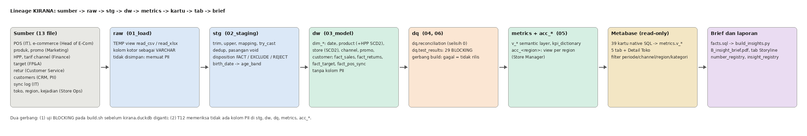

# C2. Lampiran Tata Kelola

Legenda status: **[Sudah]** diimplementasikan dan dapat diperiksa di repo; **[Usulan]** rancangan yang belum dijalankan (butuh keputusan pemilik atau akses admin).

## 1. Pemilik data per sumber

| File sumber | Sistem / pemilik data | Peran pemilik atas kualitas | Dipakai di |
| --- | --- | --- | --- |
| `sales_pos_transactions.csv` | POS toko; IT dan Store Operations | Kode toko baku, void, duplikat (DQ-01 s.d. DQ-07) | `fact_sales` |
| `sales_online_orders.csv` | Platform e-commerce; Head of E-Commerce | Label channel dan harga baku, provinsi (DQ-08 s.d. DQ-12) | `fact_sales` |
| `products.csv` | Master produk; Marketing | SKU unik, kategori baku (DQ-13, 14) | `dim_product` |
| `promotions.csv` | Marketing | Kalender, cakupan, anggaran promo | `dim_promo` |
| `product_cost_history.csv`, `channel_fee_rates.csv` | Finance | Riwayat HPP dan tarif sebagai SCD (tanpa tumpang tindih) | `dim_product_cost`, biaya channel |
| `sales_targets_2025_2026.xlsx` | FP&A | Target per region dan channel; penyesuaian saat toko pindah region | `fact_target` |
| `returns.csv` | Customer Service | `original_trx_id` valid, alasan baku (DQ-21, 22) | `fact_returns` |
| `customers.csv` | CRM | Kebijakan PII, keunikan member (DQ-18 s.d. 20) | `dim_customer` (tanpa PII) |
| `pos_sync_log.csv` | IT | Status sinkronisasi harian (DQ-23) | `fact_pos_sync`, penanda kelengkapan |
| `stores.csv`, `store_region_history.csv`, `store_events.csv` | Store Operations | Master toko, riwayat region, kejadian (renovasi) | `dim_store`, penanda data |

Pemilik **metrik** (bukan sumber): Net Sales dan GM/CM Finance Controller; Achievement dan Promo Lift Direktur Komersial; Return Rate Head of Store Operations (Store) dan Head of E-Commerce (online). Rinciannya ada di `A7_kamus_metrik.md` **[Sudah]**. Penetapan pemilik di atas adalah usulan analis berdasarkan kolom "Sumber" paket data **[Usulan]** sampai disetujui masing-masing.

## 2. Klasifikasi PII dan perlakuannya

| Kolom `customers.csv` | Kelas | Perlakuan di model | Status |
| --- | --- | --- | --- |
| `full_name`, `phone`, `email` | PII langsung | Tidak dibawa ke `stg`, `dw`, `metrics`, atau dashboard | **[Sudah]** |
| `birth_date` | PII langsung | Dihitung menjadi `age_band` di staging, kolom asli dibuang; nilai sentinel `1900-01-01` (418 member) menjadi "Tidak diketahui" | **[Sudah]** |
| `gender`, `city` | Quasi-identifier | Tidak dibawa; tidak dibutuhkan untuk dua keputusan | **[Sudah]** |
| `customer_id` / `member_id` | Pseudonim | Boleh sebagai kunci; tidak ditampilkan sebagai daftar di dashboard | **[Sudah]** |
| `member_tier`, `join_date`, `join_channel` | Non-PII | Boleh dipakai | **[Sudah]** |

Pengendali: (1) `01_load` hanya membuat TEMP view sehingga PII tidak tersimpan di `kirana.duckdb`; (2) uji **T12** (BLOCKING) memeriksa `information_schema.columns` pada `stg`, `dw`, `dq`, `metrics`, dan `acc_*` dan sudah terbukti mendeteksi cacat yang disuntik (mutasi M06); (3) `.env`, `raw_data/`, dan `docs/` ada di `.gitignore` **[Sudah]**. Catatan: dua member dapat berbagi email (DQ-19, 491 grup); karena email tidak dibawa, kedua `customer_id` tetap terpisah dan tidak digabung.

## 3. Desain hak akses

| Peran | Akses yang dirancang | Status |
| --- | --- | --- |
| Finance (Finance Controller) | Semua schema `metrics` dan `dw` non-PII | **[Usulan]** group Metabase "Finance" |
| Direktur Komersial | Semua agregat di `metrics`, tanpa `dw` baris detail | **[Usulan]** group "Komersial" |
| Store Manager | Hanya region-nya melalui schema `acc_<region>` | View **[Sudah]**; group dan izin Metabase **[Usulan]** |
| Siapa pun | Tidak ada akses ke PII (data tidak ada di model) | **[Sudah]** |

**Yang sudah diimplementasikan.** Enam schema `acc_jabodetabek`, `acc_jawa_barat`, `acc_jateng_diy`, `acc_jawa_timur`, `acc_bali_nusra`, `acc_sumatera` (di `sql/05_metrics.sql`), masing-masing berisi `v_sales_monthly` dan `v_store_performance_monthly` yang sudah difilter ke satu region, memakai definisi region yang sama dengan dashboard (`region_target_basis`). Uji **T54** (BLOCKING) memastikan tiap view hanya memuat regionnya dan gabungan seluruh region (ditambah `Lainnya` untuk pesanan online di luar enam region) sama dengan view induk; mutasi M35 membuktikan uji ini mendeteksi kebocoran. Region `Lainnya` sengaja tidak punya schema.

**Cara menerapkan di Metabase (usulan, belum dijalankan di instance ini).** Metabase edisi OSS tidak punya row-level sandboxing, jadi pembatasan dilakukan di data: (1) Admin > People > Groups: buat "Finance", "Komersial", dan satu group "Store Manager <region>"; (2) Admin > Permissions > Data: untuk group Store Manager, set izin data hanya pada schema `acc_<region>` miliknya (view data: dapat diakses; schema lain: diblokir; query native: dimatikan); (3) buat dashboard turunan untuk Store Manager yang kartunya membaca `acc_<region>`. Keterbatasan: dashboard utama memakai kartu SQL native sehingga tidak dapat dibuka oleh group yang diblokir pada schema `metrics`; perilaku izin ini belum saya verifikasi di Metabase.

Pengaman lain **[Sudah]**: public sharing dimatikan (`MB_ENABLE_PUBLIC_SHARING=false` di `compose.yaml`), tidak ada embedding, Metabase hanya mendengarkan `127.0.0.1`, koneksi DuckDB read-only, dan kredensial hanya lewat variabel lingkungan atau `.env` yang di-ignore.

## 4. Lineage

Sumber (`reports/img/lineage.drawio` dapat disunting di draw.io; dibuat ulang oleh `reports/img/build_lineage.py`) **[Sudah]**. Rantai penuh: 13 file di `raw_data/` → `raw` (TEMP view) → `stg` (`disposition` FACT / EXCLUDE / REJECT) → `dw` (star schema) → `dq` (rekonsiliasi, uji) → `metrics` dan `acc_*` → 39 kartu Metabase (`dashboard/questions/*.sql`) → 5 tab + Detail Toko → `B_insight_brief` (angka dari `reports/insights/facts.sql`). Setiap angka di laporan dapat ditelusuri lewat `number_registry.md` dan `insight_registry.md` ke view dan filter sumbernya **[Sudah]**. Alat lineage otomatis (mis. dbt docs) adalah pengembangan **[Usulan]**.

## 5. Refresh

| Aspek | Rancangan | Status |
| --- | --- | --- |
| Pemicu | Data POS tiba di pusat sekitar 01:00 sampai 01:49 (kolom `synced_at`). Jadwalkan rebuild harian pukul **03:00** agar semua toko sudah mengirim | **[Usulan]** |
| Pelaksana | Tim Data & Analytics (BI Analyst) menjalankan satu perintah, `bash scripts/build.sh`; bisa dijadwalkan lewat cron | Skrip **[Sudah]**, jadwal **[Usulan]** |
| Urutan | (1) `docker compose stop metabase`, (2) `bash scripts/build.sh` (build ke berkas sementara, menukar `kirana.duckdb` hanya bila uji BLOCKING lolos), (3) `docker compose start metabase` dan sync schema | Urutan **[Sudah]** dan didokumentasikan di README |
| Idempoten | Dua kali build menghasilkan 62 objek identik (`idempotency_check.sh`) | **[Sudah]** |
| Kesegaran | Kartu `kesegaran_data` menampilkan tanggal data terakhir (30 Jun 2026), persentase sync berhasil, toko-hari gagal | **[Sudah]** |

## 6. Monitoring

| Pemantauan | Ambang dan tindakan | Status |
| --- | --- | --- |
| Uji BLOCKING (29 uji) | Satu uji gagal menghentikan build; `kirana.duckdb` lama tetap dipakai | **[Sudah]** |
| Uji WARNING (14 uji, 3 temuan dikenal: T21, T22, T29) | Dicatat; temuan baru ditinjau pemilik sumber | **[Sudah]** |
| Rekonsiliasi raw → fakta | Selisih ≠ 0 membuat T10 dan T11 gagal | **[Sudah]** |
| Uji mutasi | 35 cacat disuntik, semua terdeteksi; jalankan setelah mengubah model | **[Sudah]** |
| Sync POS FAILED | Notifikasi ke IT bila ada toko-hari FAILED atau lebih dari 1 hari berturut-turut; dashboard menandai toko sebagai data tidak lengkap | Penanda **[Sudah]**; notifikasi **[Usulan]** |
| Freshness | Peringatan bila tanggal data terakhir lebih dari 2 hari dari tanggal rebuild | **[Usulan]** |
| Log akses Metabase | Tinjau bulanan siapa membuka dashboard dan perubahan group | **[Usulan]** |

## 7. Retensi (semuanya usulan dan asumsi, menunggu kebijakan perusahaan)

| Data | Usulan retensi | Alasan |
| --- | --- | --- |
| Data mentah transaksi | Minimal 24 bulan online, lalu arsip; paket ini mencakup 30 bulan | Perbandingan YoY dan evaluasi target butuh dua tahun lebih |
| `customers.csv` (PII) | Dibatasi pada CRM; akses di luar CRM tidak diberikan; hapus atau anonimkan sesuai permintaan penghapusan dan kebijakan privasi | Prinsip minimisasi data |
| `kirana.duckdb` | Dapat dibangun ulang; simpan tiga versi terakhir | Bukan sumber kebenaran, `raw_data/` adalah sumbernya |
| Log akses Metabase | 12 bulan | Audit |
| Hasil uji (`dq.test_results`) | Disimpan per build | Bukti kualitas |
